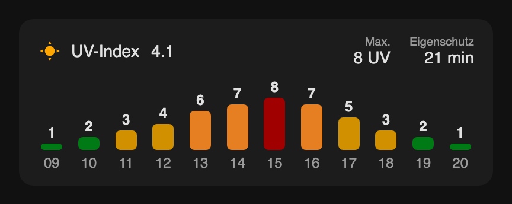

# UV Bar Card

[](https://hacs.xyz/docs/faq/custom_repositories)
[](https://github.com/fuslwusl/homeassistant-uv-bar-card/actions/workflows/validate.yaml)
[](LICENSE)

A custom Home Assistant Lovelace card that displays an hourly UV index forecast as a bar chart.



## Features

- Hourly UV index bars for the next 12 hours
- Color-coded bars by UV level (green → yellow → orange → red)
- Displays maximum UV value and estimated skin self-protection time
- Optional current UV value from a separate sensor
- Hour transitions happen at :30 (not :00) to avoid premature bar shifts

## UV Color Scale

| UV Index | Color  |
|----------|--------|
| 0–2      | Green  |
| 3–5      | Yellow |
| 6–7      | Orange |
| 8+       | Red    |

## Installation

### HACS (recommended)

1. Open HACS in Home Assistant.
2. Open the menu (⋮) → **Custom repositories**.
3. Add `https://github.com/fuslwusl/homeassistant-uv-bar-card` with type **Dashboard**.
4. Search for **UV Bar Card** and download it.
5. Reload the browser (hard refresh, or clear the frontend cache in the Companion app).

HACS adds the dashboard resource automatically.

### Manual

1. Download `uv-bar-card.js` from the [latest release](https://github.com/fuslwusl/homeassistant-uv-bar-card/releases/latest).
2. Copy it to `/config/www/community/uv-bar-card/uv-bar-card.js`.
3. Add a dashboard resource (Settings → Dashboards → ⋮ → Resources):
   - URL: `/local/community/uv-bar-card/uv-bar-card.js`
   - Type: **JavaScript module**
4. Reload the browser.

## Configuration

Add the card via the card picker (**UV Bar Card**) or as a manual card:

```yaml
type: custom:uv-bar-card
entity: sensor.your_uv_forecast_sensor
title: UV-Index
icon: mdi:weather-sunny-alert
current_entity: sensor.your_current_uv_sensor
skin_type: 2
```

### Options

| Option           | Required | Default                      | Description                                      |
|------------------|----------|------------------------------|--------------------------------------------------|
| `entity`         | yes      | –                            | Sensor with a `forecast` attribute (hourly UV)   |
| `title`          | no       | –                            | Card title; header is hidden when omitted        |
| `icon`           | no       | `mdi:weather-sunny-alert`    | Icon shown in the header                         |
| `current_entity` | no       | –                            | Sensor for the live UV value shown next to title |
| `skin_type`      | no       | `2`                          | Skin type (1–6) used for self-protection time    |

### Skin Types

| Type | MED (J/m²) | Description             |
|------|-----------|-------------------------|
| 1    | 200       | Very light (always burns)|
| 2    | 250       | Light                   |
| 3    | 350       | Medium                  |
| 4    | 450       | Olive                   |
| 5    | 600       | Brown                   |
| 6    | 1000      | Dark                    |

Self-protection time is calculated as `MED / (UV × 1.5)` in minutes.

## License

[MIT](LICENSE)
